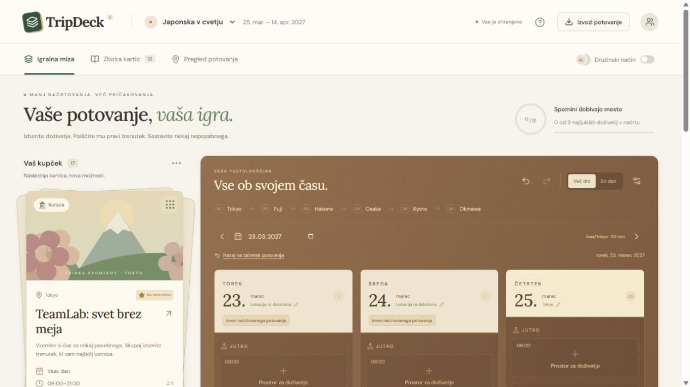

# TripDeck 🃏

**Načrtovanje potovanja kot igra Solitaire.**

TripDeck spremeni ideje za izlete, restavracije in doživetja v kartice. Povleci jih na igralno mizo, izberi datum in uro ter sestavi svoj načrt potovanja.



## Kaj omogoča?

- Uvoz aktivnosti iz CSV ali ročno dodajanje kartic.
- Načrtovanje s povleci-in-spusti ali s kliki.
- Osem kupčkov »Za pozneje«, vsak z neomejenim številom kartic.
- Preverjanje razpoložljivosti in prekrivanja terminov.
- Prosto premikanje med datumi, razveljavitev potez in lokalno shranjevanje.
- Družinsko glasovanje ter izvoz v JSON, CSV, koledar ICS ali PDF prek tiskanja.

## Kako zagnati projekt

Potrebuješ **Node.js 24** in **npm**. Račun ali API ključ za uporabo aplikacije ni potreben.

Prenesi projekt in odpri terminal v njegovi glavni mapi, kjer je datoteka `package.json`. Nato zaženi:

```bash
npm install
npm run dev
```

V brskalniku odpri naslov, ki ga terminal izpiše pri **Local**, običajno [http://127.0.0.1:5173](http://127.0.0.1:5173).

Če PowerShell v Windows blokira `npm.ps1`, uporabi:

```powershell
npm.cmd install
npm.cmd run dev
```

Terminal naj ostane odprt, dokler uporabljaš aplikacijo. Strežnik ustaviš s **Ctrl + C**.

## Prvi koraki

1. Preizkusi priloženo demo potovanje po Japonski ali ustvari svoje potovanje.
2. Dodaj aktivnosti ali uvozi [primer CSV](public/example-activities.csv).
3. Povleci kartico na datum in potrdi termin. Neodločene kartice shrani za pozneje.
4. Izvozi sestavljen načrt prek gumba **Izvozi potovanje**.

Podatki ostanejo v tvojem brskalniku. Za varnostno kopijo ali prenos načrta uporabi izvoz JSON. Demonstracijski urniki niso preverjene rezervacije.

## Ostali ukazi

```bash
npm test             # Enotski testi
npm run build        # Produkcijska različica v mapi dist
npm run preview      # Lokalni ogled produkcijske različice
```

V PowerShellu lahko tudi tukaj uporabiš `npm.cmd` namesto `npm`.

Projekt uporablja **React, TypeScript in Vite**. Podrobnosti o CSV formatu, arhitekturi, brskalniških testih in trenutnih omejitvah so v [razvojni dokumentaciji](docs/DEVELOPMENT.md).
